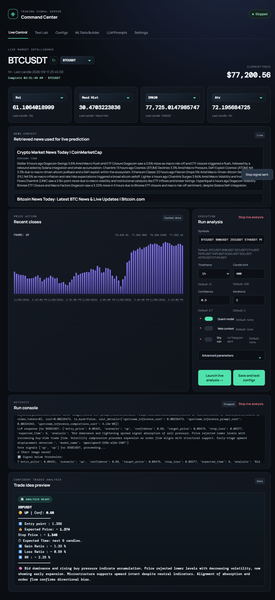
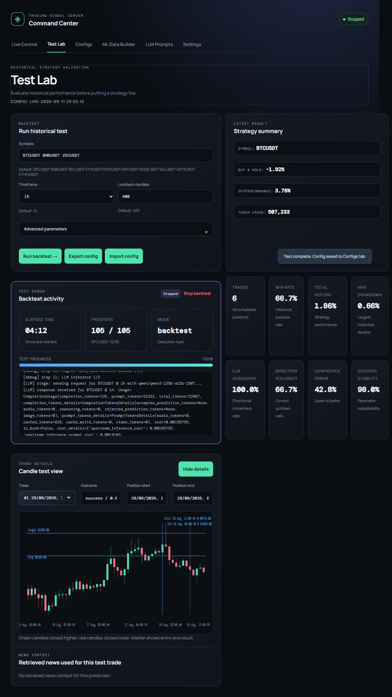
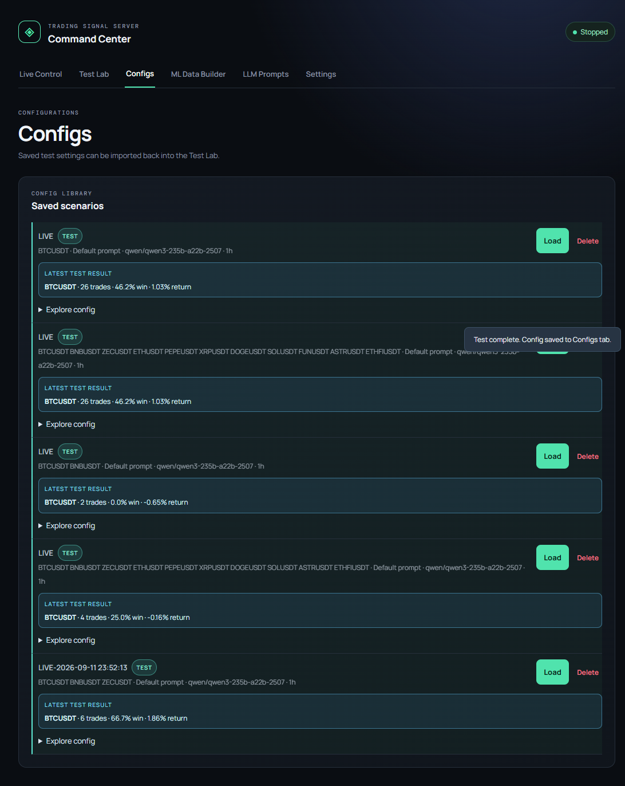
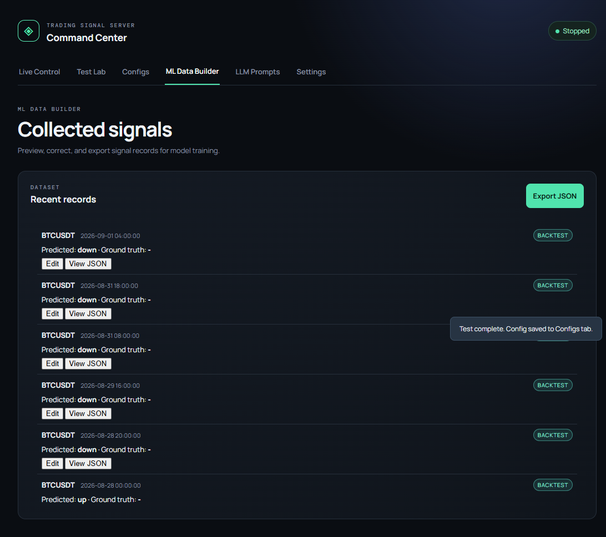
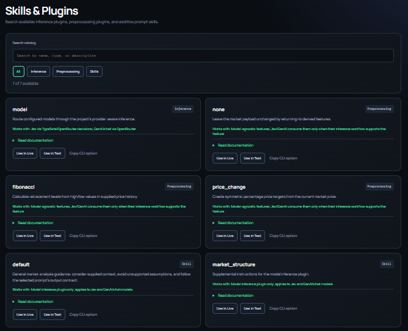

# Trading Signal Server v2

<p align="center">
  
  
  
  
  
</p>

Crypto market analysis and signal research platform supporting typed Jev decision models and chat-based LLMs, historical backtesting, quantitative context, optional Telegram alerts, and a local dashboard.

## Version 2: Model Workflows and Backtest Comparison

Version 2 expands the project with selectable inference and preprocessing plugins, reusable prompt skills, and per-model backtest metrics. The `model` plugin supports Jev's typed decisions and regular chat-model JSON signals. Jev's decision-model workflow is documented below, using Fibonacci as a built-in example, alongside chat-model use.

### What's new in v2

- **Jev decision-model support:** typed decisions, provider routing through TypeSafe or OpenRouter, and a separate backtest trade-success probability used for Brier scoring.
- **Inference plugins and preprocessors:** selectable inference backends, plus `none`, `fibonacci`, and `price_change` feature preprocessors.
- **Prompt skills:** optional reusable guidance such as `default`, `risk_first`, and `market_structure`, applied in addition to the selected model-compatible prompt.
- **Easy extension points:** users can add a documented skill folder; developers can implement and select custom inference or preprocessing plugins without changing the core dispatch flow.
- **Backtest comparison metrics:** per-model trade-success Brier scores with scored/excluded window counts, and inference latency with request count, mean, median, and p95.

### Jev decision-model workflow

- Select `typesafe/jev-1.14` (or another configured `typesafe/jev-*` model), a preprocessor whose output is exposed to Jev as suitable decision options, and a prompt that describes those options and follows Jev's typed-choice contract. A custom preprocessor may also need corresponding adapter support; adding derived features alone does not automatically make them Jev choices.
- **Built-in example — Fibonacci:** select the `fibonacci` preprocessor and use `prompts/fibonacci_jev_decision.txt`; use `prompts/fibonacci_jev_backup_decision.txt` for the GPT + Jev comparison setup.
- Use `prompts/fibonacci_decision.txt` for chat models such as GPT and Qwen. It requests JSON and is not a Jev typed-choice prompt.
- For a standalone strategy result, run one model by itself. With one model and `--iterations 2`, the same model is called twice and both decisions must agree. For a GPT + Jev run with `--iterations 2`, each model is called once and their decisions must agree. That run evaluates the combined agreement strategy, not either model's individual returns.

Unlike a chat model that generates a JSON signal, Jev selects from typed decision options supplied by the compatible inference workflow. In the built-in Fibonacci example, those options are target levels; the application maps the selected level to a direction and applies a consistent stop rule. During backtests, Jev also receives a separate native probability question about whether its selected option reaches its success condition within the shared evaluation horizon. The probability of choosing an option is **not** its trade-success probability.

### Saved backtest results

The following are observed results from this project's saved BTCUSDT, 1-hour, 400-candle experiments. They are illustrative backtests, not a guarantee of future performance. The standalone runs share the same reported candle range; the GPT + Jev run starts and ends two candles later. Brier is lower-is-better; its scored-window count is shown in parentheses. Inference latency is average time per call. Token columns show the totals recorded for each saved run, not per-call usage.

| Configuration | Win rate | Strategy return | Outperformance vs. buy-and-hold | Trade-success Brier | Mean inference latency | Total tokens | Output tokens | Agreement |
| --- | ---: | ---: | ---: | ---: | ---: | ---: | ---: | ---: |
| Qwen alone, 2 calls/window | 39.3% | +0.30% | +8.55 pp | 0.257 (31) | 13.35 s/call | 1,526,743 | 11,181 | **97.0%** |
| GPT-6 Luna alone, 2 calls/window | 55.0% | +1.01% | +9.34 pp | **0.214 (32)** | 12.35 s/call | **1,093,009** | 40,129 | 62.9% |
| Jev 1.14 alone, 2 calls/window | 63.0% | +0.14% | +8.33 pp | 0.263 (28) | **2.21 s/call** | 1,534,862 | **6,976** | 96.9% |
| GPT-6 Luna + Jev 1.14 hybrid (optimized call mix: replaces GPT's second call), 1 call/model/window | **77.3%** | **+2.69%** | **+10.14 pp** | GPT 0.266 (34); Jev 0.267 (33) | GPT 10.81 s; Jev 2.32 s | 1,387,123 | 24,861 | 68.6% |

Bold marks only the best value in each metric column (lower is better for Brier, latency, and token counts). Token totals are per saved run, not normalized by calls or windows. Standalone agreement is repeat-call direction consistency; hybrid agreement is the fraction of windows where GPT and Jev agreed, so these agreement figures are not directly comparable.

### GPT + Jev hybrid compared with GPT alone

The optimized call-mix variant replaces the second GPT call in each window with one Jev call. It is designed to combine GPT with a faster decision model, but is not a controlled proof of improved overall efficiency. The hybrid run covers a slightly shifted candle range (two candles later at both ends), and its overall token count includes both models.

| Metric | GPT alone, 2 GPT calls/window | GPT + Jev, 1 call/model/window | Observed difference |
| --- | ---: | ---: | ---: |
| Win rate | 55.0% | 77.3% | +22.3 percentage points |
| Strategy return | +1.01% | +2.69% | +1.68 percentage points |
| Outperformance vs. buy-and-hold | +9.34 pp | +10.14 pp | +0.80 percentage points |
| GPT trade-success Brier | 0.214 (32) | 0.266 (34) | +0.052; worse calibration in the hybrid run |
| GPT mean latency per call | 12.35 s | 10.81 s | 1.54 s lower; Jev adds a 2.32 s/call request |
| Total tokens, all models | 1,093,009 | 1,387,123 | +294,114 (+26.9%); not a total-token reduction |
| Output tokens, all models | 40,129 | 24,861 | 15,268 fewer (-38.0%); hybrid total includes Jev output |

The saved dollar-cost field is zero for these runs, so they do not establish any price or cost savings. Total-token and output-token totals are not per-model in the hybrid record, and the changed model mix and candle range limit direct efficiency comparisons. The hybrid did have higher observed win rate and return in this sample, but it does not prove Jev caused the change or will improve future results. Samples are limited, and returns exclude fees and slippage.

In these saved tests, Jev's clearest standalone strengths are speed and high repeat-call direction agreement. The hybrid had the strongest observed ensemble return and win rate, but its GPT Brier score was higher (worse) than GPT alone. The result is promising evidence that Jev may complement GPT, not a guarantee of future performance. Hybrid returns belong to the combined agreement strategy; individual model Brier scores do not represent individual strategy returns. Ambiguous outcomes were excluded from Brier.

For a stronger comparison, keep the same symbol, interval, candles, horizon, preprocessor, risk rules, and prompt-to-model order. Review each model's Brier score together with its scored/excluded window counts, and review hybrid returns separately from standalone returns.

## Key Capabilities

- Public Binance market-data access for candles, order-book metrics, recent trades, and technical-indicator calculations, subject to API availability and rate limits.
- Web-search context for recent crypto news, whale activity, policy, macro, and exchange updates.
- OpenRouter integration to choose from free and paid LLM models according to your needs and budget.
- Quantitative models that add extra evidence to LLM analysis, news context, candle data, and indicators.
- Historical testing of configurations and prompts before live signal analysis, with metrics covering LLM quality and trading performance, including win rate, returns, drawdown, and outperformance against buy-and-hold.
- Optional Telegram alerts for qualifying signals when Telegram credentials are configured.
- Saved configurations and prompt files for repeatable experiments and manual comparison.
- ML dataset building from signals collected during testing and live operation.
- Automatic future-candle ground-truth labeling for live signals when enough later-session data becomes available.
- Performance controls including repeated LLM iterations for consistency checks, parallel execution of selected quant-model families, and prompt files mapped to voting models and iterations.
- Local dashboard controls for live analysis, testing, saved configs, prompt management, settings, ML data, logs, and results review.
- Selectable inference plugins, preprocessors, and prompt skills for provider-specific model workflows.

## Overview

This project combines:

- live crypto market data, order-flow snapshots, and indicators,
- provider-routed model signal generation for Jev decisions and chat-model completions,
- multi-model voting for decision stability,
- quant forecasting support,
- web/news context enrichment,
- historical backtesting and metrics,
- a local GUI dashboard for monitoring and controls.

## Features

- Multi-symbol market analysis
- Technical indicator framework
- LLM consensus voting
- Telegram notifications
- Dry-run mode for safe testing
- Quant model support
- Web search context injection
- Backtesting with performance metrics
- Request caching and dataset export
- Local dashboard UI
- Prompt library and saved configuration management

## GUI / Dashboard

This project already includes a graphical interface in the `dashboard/` folder.

Run it with:

```bash
python dashboard/app.py
```

Then open:

```text
http://localhost:8080
```

The dashboard includes:

- Live Control
- Test Lab
- Configs
- LLM Prompts
- Settings
- ML Data Builder
- runtime logs and progress output

### Dashboard Screenshots

The dashboard images in `dash_images/` show the main workflow areas: live controls, test-lab validation, configuration management, ML data tools, and the Skills & Plugins catalog.











## Easy Start (Google Colab)

Run these cells in Google Colab to clone the project, install its dependencies, and perform a safe dry run:

```python
!git clone https://github.com/haidarali0/Trading-Signal-Server.git
%cd Trading-Signal-Server
!pip install -r requirements.txt

import os
os.environ["OPENROUTER_API_KEY"] = "get your api (free)"

!python main.py --dry-run
```

Replace the placeholder with your OpenRouter API key. Do not commit a real API key to the repository.

## Quick Start

### 1) Install dependencies

```bash
pip install -r requirements.txt
```

### 2) Add environment variables

Create a `.env` file:

```env
OPENROUTER_API_KEY=your_key_here
# Optional: use the direct TypeSafe API for Jev decision models
TYPESAFE_API_KEY=your_typesafe_key_here
MODEL_NAME=qwen/qwen3-235b-a22b-2507
TELEGRAM_BOT_TOKEN=your_bot_token
TELEGRAM_CHAT_ID=your_chat_id
```

`MODEL_NAME` is only the default fallback. You can replace it with any model available through OpenRouter.
`TYPESAFE_API_KEY` is optional and is only needed to route configured Jev decision models directly through TypeSafe. If it is unset, Jev uses OpenRouter's typed decisions endpoint and `OPENROUTER_API_KEY`; regular chat models continue to use OpenRouter either way. When running Jev and chat models together with direct TypeSafe, both API keys are needed.

### 3) Launch dashboard

```bash
python dashboard/app.py
```

### 4) Run analysis

```bash
python main.py
```

### 5) Safe validation mode

```bash
python main.py --dry-run
```

## Command-Line Workflows

All live and test workflows use `argparse`, so the same application can be configured from the command line without editing source code. See every available option with:

```bash
python main.py --help
python -m backtesting.backtest --help
```

### Live Commands

```bash
# Analyze the configured symbols
python main.py

# Analyze selected symbols and timeframe
python main.py --symbols BTCUSDT ETHUSDT --interval 4h --limit 500

# Run safely without Telegram delivery
python main.py --dry-run

# Use several LLMs for voting across iterations
python main.py --model-names openai/gpt-4o-mini google/gemini-2.5-flash --iterations 2

# Add quant analysis and web context
python main.py --quant-enabled --quant-models random_forest extra_trees --web-search-enabled
```

Useful live options include `--symbols`, `--interval`, `--limit`, `--model-names`, `--iterations`, `--prompt-files`, `--indicators`, `--higher-timeframes`, `--confidence-threshold`, `--gain-ratio-threshold`, `--dry-run`, and the `--quant-*` and `--web-search-*` options.

### Test and Backtest Commands

Backtesting evaluates historical signals without sending live alerts. It writes machine-readable results locally to `backtest_results/`.

```bash
# Backtest one symbol with default settings
python -m backtesting.backtest --symbols BTCUSDT

# Compare symbols, timeframe, and step size
python -m backtesting.backtest --symbols BTCUSDT ETHUSDT --interval 4h --lookback 400 --step 5

# Test multiple LLMs and quant models
python -m backtesting.backtest --symbols BTCUSDT --model-names openai/gpt-4o-mini google/gemini-2.5-flash --quant-enabled --quant-models random_forest extra_trees

# Compare a chat model with Jev using model-matched Fibonacci prompts
python -m backtesting.backtest --symbols BTCUSDT --lookback 400 --interval 1h --step 10 --iterations 2 --max-expected-time 12 --model-names openai/gpt-6-luna typesafe/jev-1.14 --prompt-files prompts/fibonacci_decision.txt prompts/fibonacci_jev_backup_decision.txt --preprocessors fibonacci --output-dir backtest_results/gpt_jev

# Control token usage, cost, and output location
python -m backtesting.backtest --symbols BTCUSDT --token-limit 10000 --max-cost 1.0 --output-dir backtest_results/experiment_01
```

Important backtest options include `--lookback`, `--step`, `--iterations`, `--n`, `--model-names`, `--token-limit`, `--input-token-price`, `--output-token-price`, `--max-cost`, `--output-dir`, and the `--quant-*` and `--web-search-*` options.

For backtests, one prompt file is shared by every model; otherwise, prompt files map to models by list position. Keep `--model-names` and `--prompt-files` in the same order. With two models and two iterations, the backtest calls each model once per window and requires agreement on direction before opening a combined trade. Use one model with `--iterations 1` for that model's standalone strategy return; use one model with `--iterations 2` to test repeatability, noting that both calls must agree.

## Inference Plugins and Skills

The built-in `model` inference plugin is the project's model-backed signal path. It sends configured Jev decision models through the TypeSafe or OpenRouter decisions workflow, and other supported models through OpenRouter chat completions.

### Compatibility at a glance

“GenAI/chat” means models selected through the ordinary chat-completions path;
Jev means the configured `typesafe/jev-*` typed decision models.

| Extension | Jev | GenAI/chat models | Notes |
| --- | --- | --- | --- |
| `model` inference plugin | Yes | Yes | Routes Jev to typed target choices and chat models to JSON signal generation. |
| `risk_first`, `market_structure` skills | Yes, via `model` | Yes, via `model` | Add supplemental prompt guidance. |
| `none` preprocessor | Yes (baseline) | Yes (baseline) | Adds no derived features; leaves the normalized market input unchanged. |
| `fibonacci` preprocessor | Yes (built-in target-choice example) | Yes (feature context) | Provides retracement levels. The current Jev adapter exposes these as target choices; chat models can use them as context. Other preprocessors can be used with Jev when their outputs are supported by the adapter and a matching prompt. |
| `price_change` preprocessor | Feature output only | Yes (feature context) | Provides fixed percentage-change levels. The current Jev adapter does not expose these levels as typed target choices. |
| `prompts/genai_default_trading.txt` | No | Yes | Default chat-model JSON signal prompt; loaded automatically unless a custom prompt is selected. |
| `prompts/fibonacci_decision.txt` | No | Yes | Chat-model JSON signal prompt with Fibonacci target rules. |
| `prompts/fibonacci_jev_decision.txt`, `prompts/fibonacci_jev_backup_decision.txt` | Yes | No | Jev typed-choice prompts for Fibonacci target selection. |

The **Skills & Plugins** dashboard catalog shows these compatibility labels on
each extension card. A preprocessor being model-agnostic means it can run
independently of a provider; it does not guarantee every inference workflow
consumes its output or exposes those features as typed choices.

```bash
python main.py --inference-plugin model --inference-skill risk_first --dry-run
python main.py --inference-plugin model --model-names typesafe/jev-1.14 --prompt-files prompts/fibonacci_jev_decision.txt --preprocessors fibonacci --dry-run
```

Skills are additive instruction/knowledge text used by the `model` plugin. The selected prompt (including its required signal output format) remains in effect; selected skills are appended as supplemental guidance. The default GenAI/chat prompt is stored in `prompts/genai_default_trading.txt` and loaded automatically when no `--prompt-files` are provided. A custom prompt file replaces it, while the selected skill is still appended. The `default` skill provides general conservative analysis rules, `risk_first` emphasizes risk and abstention, and `market_structure` focuses on range behavior and confirmation. Add a folder under `skills/` with an `instructions.txt` and `README.md` to make another skill available as `--inference-skill <name>`. Legacy root-level `.txt` skills are still supported.

Preprocessors run after market data, indicators, quant output, and web context are assembled, but before inference. They receive the complete normalized input object (`market`, newest-first `price_history`, optional `market_microstructure`, `trade_flow`, `volatility`, `higher_timeframes`, `quant`, and `web_context`) and append outputs under `derived_features`. The built-in options are `none`, `fibonacci`, and `price_change`. A Jev workflow can use a preprocessor when the inference adapter exposes its relevant output as decision options and the prompt matches those options; custom preprocessors may require adapter support. As a built-in example, Jev's current adapter exposes Fibonacci levels as target choices, while `price_change` currently supplies relative levels to model context rather than Jev choices. GenAI/chat models can consider either feature set when useful. Backtests pass only candles available at each historical test point, so derived features cannot see future candles.

Decision models are listed in `config.DECISION_MODELS`; `typesafe/jev-1.13` and `typesafe/jev-1.14` are currently configured. These IDs are passed unchanged to OpenRouter. If `TYPESAFE_API_KEY` is set in `.env` or Dashboard Settings, Jev automatically uses the direct TypeSafe SDK and maps the selected IDs to `jev-1.13.0` or `jev-1.14.0`, respectively. If that key is not set, Jev uses OpenRouter's typed decisions endpoint. Other models continue to use normal OpenRouter chat completions; a run combining Jev with other models needs both API keys to use direct TypeSafe for Jev and OpenRouter for the remaining models.

The provider route is automatic for configured Jev model IDs: set `TYPESAFE_API_KEY` to use the direct TypeSafe SDK; otherwise set `OPENROUTER_API_KEY` and the app sends the typed decision request through OpenRouter. There is no separate provider flag. If both keys are present, Jev uses direct TypeSafe, while regular chat models still use OpenRouter. The direct route requires the `typesafe-sdk` dependency from the project requirements. OpenRouter access requires that the selected Jev model is available to the account.

**Built-in Jev/Fibonacci example:** select `--preprocessors fibonacci` and use `--prompt-files prompts/fibonacci_jev_decision.txt` or `prompts/fibonacci_jev_backup_decision.txt`. The Fibonacci preprocessor calculates the 0, 0.236, 0.382, 0.5, 0.618, 0.786, and 1 retracement prices from the supplied candle window's high and low. The request presents every usable level as a target choice, plus `no_trade`. The selected level and its choice probability are retained as `target_fibonacci_level`, `target_fibonacci_price`, and `confidence`; this is **not** interpreted as probability of a profitable trade. During backtests, the same request also includes a native `noul` question for `trade_success_probability`. The question evaluates whether the target Jev selects is reached before its corresponding stop within the shared backtest horizon (12 candles by default). The OpenRouter adapter reads this from `answers.trade_success.noul`; the direct TypeSafe adapter reads the typed `Noul` answer from the SDK. The app infers `scenario` from whether the target is above or below current price. The stop is the nearest opposing Fibonacci level, with ATR or 1% of current price as fallback. For `no_trade`, entry, target, and stop are set to current price. The adapter leaves `analysis` empty because the decision API returns choices and probabilities, not narrative. These levels come from the supplied candle window and are not pivot-confirmed or predictive guarantees.

The Jev success-probability `noul` question is included in the initial request only during backtests and uses their configured common horizon; normal live runs keep the existing decision request. The default chat prompt and `prompts/fibonacci_decision.txt` request JSON and are not suitable for Jev's typed-choice interface. The built-in Fibonacci setup expects its Fibonacci preprocessor and a Jev-compatible prompt; the CLI prints a non-blocking setup warning and the GUI explains the issue and alternatives when that setup is incomplete.

Example Jev live run (the `--dry-run` flag suppresses Telegram alerts):

```bash
python main.py --symbols BTCUSDT --model-names typesafe/jev-1.14 --iterations 1 --prompt-files prompts/fibonacci_jev_decision.txt --inference-plugin model --inference-skill default --preprocessors fibonacci --dry-run
```

With `TYPESAFE_API_KEY` configured, this command automatically calls the direct TypeSafe API for Jev; no provider option is needed.

To use Jev through OpenRouter instead, leave `TYPESAFE_API_KEY` unset and provide `OPENROUTER_API_KEY`:

```bash
python main.py --symbols BTCUSDT --model-names typesafe/jev-1.14 --iterations 1 --prompt-files prompts/fibonacci_jev_decision.txt --inference-plugin model --inference-skill default --preprocessors fibonacci --dry-run
```

### Add skills and plugins

**Users can add a skill without writing code:** create `skills/<skill-name>/instructions.txt` with focused supplemental guidance and a `README.md` describing its purpose and limits, then choose it with `--inference-skill <skill-name>` (or in the dashboard). A skill adds instructions; it does not replace the selected prompt or its output contract. See the [skills contributor guide](skills/README.md).

**Developers can add plugins using the existing interfaces:**

- An inference plugin derives from `plugins.InferencePlugin` and implements `infer(request)`, returning `(signal_dict, usage)`. The shared validator requires `scenario` (`up`, `down`, or `no_trade`), confidence from 0 to 1, positive entry price and expected time, numeric target and stop prices, and string analysis. Select it with `--inference-plugin package.module:ClassName`.
- A preprocessing plugin derives from `plugins.PreprocessingPlugin` and implements `transform(market_data)`, returning a JSON-serializable dictionary of derived features. Select it with `--preprocessors package.module:ClassName`. The runner adds its output under `derived_features`.

Put custom plugin code in an importable Python module available to the project. Built-in plugins are listed in the dashboard catalog; custom plugins can be invoked by their module and class path. No edits to the inference dispatcher are required for a custom plugin. See the [plugin contributor guide](plugins/README.md) for contracts and built-in examples. The dashboard exposes built-in plugin, skill, and preprocessor choices and displays the selected run configuration; CLI runs print their selections at startup.

## Project Structure

```text
Trading-Signal-Server/
├── main.py
├── config.py
├── requirements.txt
├── README.md
├── backtesting/
├── crypto_data/
├── dashboard/
├── engine/
├── helper/
├── ml_builder/
├── quant/
├── plugins/
├── skills/
├── web/
├── tests/
└── dash_images/
```

The `.env`, runtime `cache/` data, and `backtest_results/` are excluded from version control. The exception is `cache/saved_configs.json`, which stores shareable dashboard configurations and their saved comparison summaries and can be committed with the project. Do not put credentials or other secrets in saved configurations. Prompt files under `prompts/` are user-configurable project inputs and may be committed when they are intended to be shared.

## Main Commands

```bash
# Live analysis
python main.py

# Specific symbols
python main.py -s BTCUSDT ETHUSDT --interval 4h --limit 500

# Dry run
python main.py --dry-run

# Quant model enabled
python main.py --quant-enabled --quant-input-data indicators

# Web context enabled
python main.py --web-search-enabled --web-search-topics policy news

# Backtest
python -m backtesting.backtest -s BTCUSDT
```

## Backtesting

The project includes a historical evaluation engine that measures:

- win/loss rate
- return performance
- buy-and-hold comparison
- token cost tracking
- confidence and direction accuracy

Outputs are saved in `backtest_results/` and include summary JSON/CSV files.

Backtest returns currently do not model exchange fees, slippage, or order execution latency. Outcomes are evaluated candle by candle; if one candle crosses both a target and stop-loss, the outcome is marked ambiguous rather than assuming which was hit first.

The Test Lab reports a per-model binary **trade-success Brier score** (lower is better). All models are scored on the same `--max-expected-time` horizon. Standard LLMs use their generated `confidence` as the probability that the proposed target is reached before its stop within this shared horizon; the backtest adds that definition to the model prompt. Jev's Fibonacci-choice probabilities have a different meaning, so they are not reused as trade confidence: the initial decisions request also asks a native `noul` question whose `answers.trade_success.noul` estimates success for the selected target, its corresponding stop, and shared horizon. A target hit is 1; a stop hit or no target/stop hit before the horizon is 0. No-trade signals and same-candle ambiguous outcomes are excluded. The GUI reports scored windows and excluded cases alongside each model's average, weighting each historical window equally when a model is queried repeatedly. Brier calibration uses the shared test horizon, while the strategy's recorded trade outcome still uses its response `expected_time`. For custom prompts or inference plugins, preserve the same confidence meaning to make scores comparable. Brier scores assess calibration on this test sample; they do not prove future profitability or account for fees, slippage, or execution latency.

Backtests also record **inference latency** per model using a monotonic wall-clock timer around each inference call. The saved summary and Test Lab report call count, mean, median, and 95th-percentile latency; failed inference attempts are included. This measures end-to-end inference-call time (including provider/network delay, response handling, and validation), not market-data preparation or actual exchange order execution latency. Compare models under the same run conditions and use the call counts and percentile alongside the mean because network and provider load can vary.

## Data & Caching

The app stores structured runtime data in `cache/` for debugging and traceability:

- request payloads
- symbol snapshots
- web search output
- quant model results
- live stop state

## Configuration

Configuration is split between environment variables, defaults in `config.py`, dashboard settings, and command-line arguments.

### Private Environment Variables

Create `.env` locally. Never commit it or place real values in source code:

```env
OPENROUTER_API_KEY=your_key_here
# Optional: enables direct TypeSafe routing for Jev decision models
TYPESAFE_API_KEY=your_typesafe_key_here
MODEL_NAME=qwen/qwen3-235b-a22b-2507
TELEGRAM_BOT_TOKEN=your_bot_token_here
TELEGRAM_CHAT_ID=your_chat_id_here
```

`config.py` reads these values with `python-dotenv`. `TYPESAFE_API_KEY` is optional: when configured, Jev decision models use the direct TypeSafe API; otherwise Jev uses OpenRouter's typed decisions endpoint. Regular chat models always use OpenRouter. Trading defaults include symbols, candle limits, intervals, higher timeframes, indicators, confidence thresholds, and gain-ratio thresholds. Runtime overrides are available through `main.py` and the dashboard Settings tab.

### Comparing and Saving Results

Every backtest writes results incrementally so completed trades remain available if a long run stops early:

- `backtest_results/{SYMBOL}_results.json`: detailed trade-by-trade results, predictions, outcomes, returns, chart markers, and context.
- `backtest_results/summary.json`: aggregate win/loss, return, benchmark, token, and cost metrics.
- `backtest_results/{SYMBOL}_results.csv`: tabular output for spreadsheet or analysis workflows.

Use a separate output directory for each experiment, then compare the generated `summary.json` files:

```bash
python -m backtesting.backtest --symbols BTCUSDT --interval 1h --output-dir backtest_results/baseline
python -m backtesting.backtest --symbols BTCUSDT --interval 1h --quant-enabled --output-dir backtest_results/with_quant
```

This makes it possible to compare the same market and timeframe across prompt, model, indicator, quant, and threshold configurations without overwriting earlier results.

## Automatic Signal Collection and Labeling

Signals are collected automatically in `ml_builder/ml_data/dataset.jsonl`:

1. A live or backtest prediction is saved with its symbol, timestamp, predicted label (`up`, `down`, or `no_trade`), confidence, entry, target, stop-loss, expected time, analysis, and input features.
2. In backtesting, future candles are evaluated immediately. The record receives `outcome`, `return_pct`, `ground_truth`, and outcome timing.
3. In live mode, the signal is kept in a pending file until enough future candles are available. The application then checks whether the target or stop-loss was reached and updates the record with `auto_labeled: true`.
4. `append_record` avoids duplicate signal windows, while `list_records`, `export_records`, and `update_record` support dashboard and training workflows.

This produces labeled examples from actual signal outcomes instead of requiring labels to be entered manually.

## Parallel Quant Models

The quant engine prepares one shared feature matrix from OHLCV data, indicators, or both. With `--quant-models`, the configured model families train concurrently using a `ThreadPoolExecutor`:

```bash
python main.py --quant-enabled \
  --quant-models random_forest extra_trees gradient_boosting \
  --quant-input-data both \
  --quant-target-mode percentage_return
```

Supported regression models include `random_forest`, `extra_trees`, `gradient_boosting`, `hist_gradient_boosting`, `k_neighbors`, `ridge`, `svr`, `sgd`, and `passive_aggressive`. Direction targets can use classifiers such as `random_forest`, `extra_trees`, `gradient_boosting`, `hist_gradient_boosting`, or `logistic_regression`.

Each model is validated with walk-forward splits and reports metrics, confidence, reliability, and acceptance status. Accepted models are combined into a reliability-weighted ensemble; the best accepted model is also selected for the LLM context. The same quant configuration can be used during backtesting to compare model families fairly.


## Model-Specific Prompt Contracts

The inference paths intentionally use different output contracts:

- **Jev:** returns a typed choice from the decision options supported by its inference workflow. Pair the preprocessor and prompt so the options Jev receives match the choices described in the prompt. **Built-in Fibonacci example:** Jev chooses from available Fibonacci targets or `no_trade`; use `prompts/fibonacci_jev_decision.txt` or `prompts/fibonacci_jev_backup_decision.txt` with `--preprocessors fibonacci`. The application converts the selected target into the signal fields used by backtesting and live analysis.
- **Chat models:** return a JSON signal with `scenario`, `confidence`, `entry_price`, `target_price`, `stop_loss`, `expected_time`, and `analysis`. Use `prompts/fibonacci_decision.txt` for a Fibonacci comparison or `prompts/genai_default_trading.txt` for the default chat workflow.

Do not give Jev a prompt that requires JSON or give a chat model a prompt that requires only a typed choice. In a multi-model backtest, provide one prompt per model in the same order, or one shared prompt file if the prompt is compatible with every selected model.

During backtests, chat-model `confidence` is defined as probability that the proposed target reaches before its stop within the common backtest horizon. Jev's probability of selecting a decision option is not trade-success probability; Brier scoring uses Jev's separate native trade-success probability instead.

## Notes

- Use dry-run mode before live signal delivery.
- Review cached prompt payloads when debugging decisions.
- Keep prompt templates in `prompts/` for testing different strategies.
- The GUI is the fastest way to configure and monitor the workflow.

## License

This project is intended for research and experimentation in crypto market analysis. Use responsibly and in compliance with local laws and provider terms.
